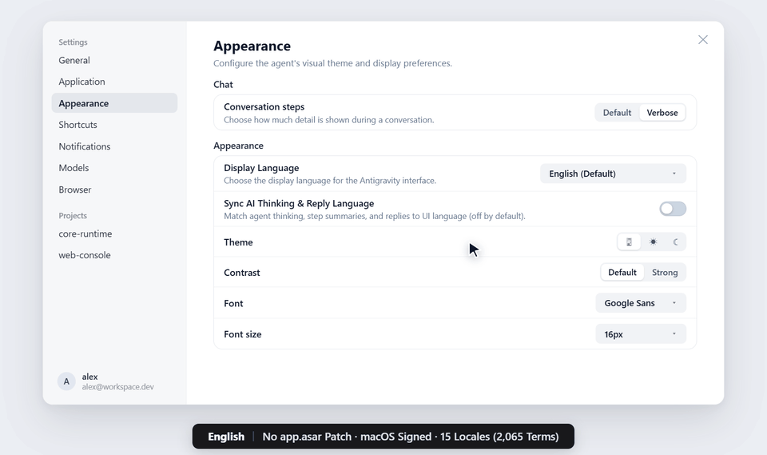

<div align="center">

# antigravity-langpack

**Zero-binary, zero-ASAR-patch, self-healing 14-language native UI localization for Google Antigravity (`Antigravity` & `Antigravity - Insiders`) on macOS, Windows, and Linux.**

<p>
  <b>English</b> ·
  <a href="./docs/README.zh-CN.md">简体中文</a> ·
  <a href="./docs/README.zh-TW.md">繁體中文</a> ·
  <a href="./docs/README.ja.md">日本語</a> ·
  <a href="./docs/README.ko.md">한국어</a>
</p>


<p align="center">
  
</p>

</div>

---

## Why `antigravity-langpack`?

Unlike traditional `app.asar` patchers or compiled `.exe` wrappers, **`antigravity-langpack`** operates via official local DevTools runtime bindings with **100% plain-text scripts**:

1. **Zero `app.asar` Modification (macOS Gatekeeper & Keychain Safe)**:
   Never touches `/Applications/Antigravity.app` or `Program Files`. Preserves Google's official Apple notarization signature on macOS — **zero "App is damaged" alerts** and **zero repeated Keychain password prompts**.
2. **Survives Daily Client Updates Automatically**:
   Both `Antigravity` (Stable) and `Antigravity - Insiders` stay localized across daily auto-updates (`--updated`) without re-running any patch script.
3. **Native In-App Language Switcher (<30ms Instant Switch)**:
   Embeds a clean, native **Display Language** selector directly inside **`Settings → Appearance`**. Switch between **14 full languages** and original English in real time without restarting or reloading windows.
4. **100% Plain-Text, Zero Binaries, Zero Third-Party Dependencies, Zero Admin Needed**:
   Contains **zero `.exe` / `.dll` / `.node` files** and **zero `npm` dependencies**. Installs strictly under user-level directories (no `sudo` or Administrator privileges required).
5. **Key-Free AI Self-Healing Dictionary**:
   When a new client release introduces untranslated UI buttons, the background service automatically translates only the new phrases via your local signed-in Antigravity CLI (with a 12-hour cooldown) into `dict/learned.<locale>.json` — **zero external API keys required**.

---

## Pre-Bundled Full Languages (1,920+ Entries Each)

| Code | Display Option | Convention & Highlights |
| :--- | :--- | :--- |
| `en` | **English (Default)** | Instant zero-restart switch back to original English UI |
| `zh-CN` | **简体中文** | **1,920 full entries** — Modern full-Chinese terminology (`智能体 / 子智能体 / 生成产物 / 侧边追问`) |
| `zh-SG` | **简体中文 (英文术语)** | **1,920 full entries** — Simplified Chinese UI keeping core English tech terms (`Agent / Subagent / Artifact / Workspace`) |
| `zh-TW` | **繁體中文** | **1,920 full entries** — Aligned with official VS Code Traditional Chinese (`程式碼 / 檔案 / 專案 / 預設 / 快取`) |
| `ja` | **日本語 (Japanese)** | **1,920 full entries** — Standard katakana developer terms (`エージェント / アーティファクト / サイド質問`) |
| `ko` | **한국어 (Korean)** | **1,920 full entries** — Modern Korean developer UX (`에이전트 / 아티팩트 / 워크스페이스`) |
| `vi` | **Tiếng Việt (Vietnamese)** | **1,920 full entries** — Clean Vietnamese UI keeping standard Git & AI terms |
| `hi` | **हिन्दी (Hindi)** | **1,920 full entries** — Modern Devanagari developer UX |
| `id` | **Bahasa Indonesia (Indonesian)** | **1,920 full entries** — Concise Indonesian software UI |
| `th` | **ภาษาไทย (Thai)** | **1,920 full entries** — Layout-safe compact Thai developer UI |
| `es` | **Español (Spanish)** | **1,920 full entries** — Aligned with VS Code official Spanish (`Agente / Artefacto / Configuración`) |
| `fr` | **Français (French)** | **1,920 full entries** — Aligned with VS Code official French (`Sous-agent / Artefact / Paramètres`) |
| `de` | **Deutsch (German)** | **1,920 full entries** — Aligned with VS Code official German (`KI-Agent / Artefakt / Einstellungen`) |
| `pt` | **Português (Portuguese)** | **1,920 full entries** — Aligned with VS Code official Portuguese (`Agente / Artefato / Configurações`) |
| `it` | **Italiano (Italian)** | **1,920 full entries** — Aligned with VS Code official Italian (`Agente / Artefatto / Impostazioni`) |

---

## Quick Start (Zero Admin / Zero `sudo`)

Requires official **Node.js >= 22.13.0**.

```bash
git clone https://github.com/CHANPAJN/antigravity-langpack.git
cd antigravity-langpack

# Install (defaults to zh-CN, or pass --lang ja / ko / zh-TW / es / fr / de / pt / it / vi)
node cli.mjs install --lang ja

# Or double-click `install.cmd` on Windows / run `sh install.sh` on macOS & Linux
```

### macOS Optional Zero-Relaunch Dock Wrapper

By default on macOS, the user-level `LaunchAgent` automatically attaches to `Antigravity.app` and `Antigravity - Insiders.app`. If you prefer 0-second attachment directly from the Dock:

```bash
node cli.mjs install --lang ja --mac-launcher
```

### Switching Languages & Commands

- **In-App Dropdown**: Open **`Settings → Appearance → Display Language`** and pick any language for an instant `<30ms` switch.
- **CLI**:
  ```bash
  node cli.mjs status        # Check daemon status & active ports
  node cli.mjs lang          # List all 14 locales & entry counts
  node cli.mjs lang ja       # Switch to Japanese instantly
  node cli.mjs lang en       # Switch back to original English
  node cli.mjs sync-ai       # Manually trigger key-free incremental AI dictionary sync
  node cli.mjs check         # Verify zero binaries & validate all scripts/JSON
  node cli.mjs uninstall     # Cleanly restore English UI & remove autostart
  ```

---

## License

Released under the [PolyForm Noncommercial License 1.0.0](./LICENSE). Free for personal use, security auditing, and internal noncommercial workflows. Commercial resale or removal of attribution is prohibited.
