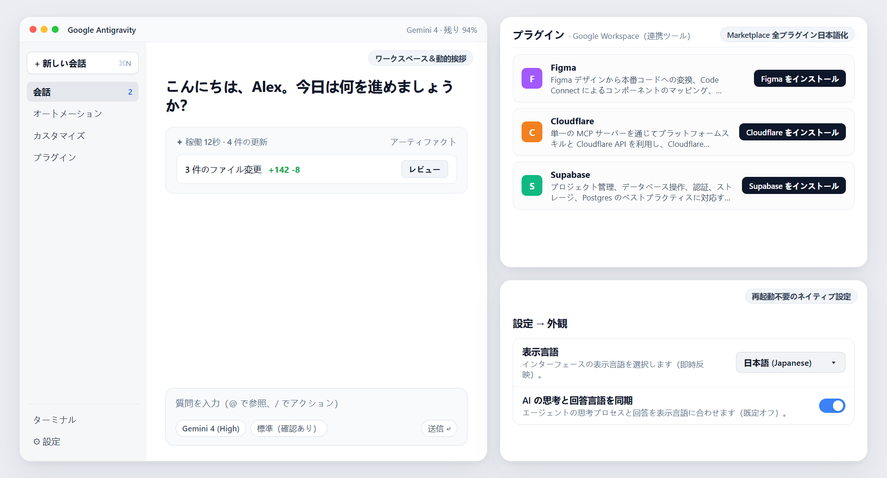

<div align="center">

# antigravity-langpack

**Google Antigravity（Stable & Insiders）** および **Antigravity IDE** 向けプレーンテキスト・ネイティブ日本語化＆多言語パック。  
単一の軽量デーモンが IDE 外殻の公式言語パック同期と、標準言語パックでは翻訳されない**右側の Agent パネル・Antigravity Settings・Swarm ボード・インライン操作ボタン**のリアルタイム翻訳を一括処理。app.asar 非改変・macOS 公式署名を維持し、全15ロケール（各 2,865 語・Marketplace 完全収録）を即時切り替え。

<p>
  <a href="../README.md">English</a> ·
  <a href="./README.zh-CN.md">简体中文</a> ·
  <a href="./README.zh-TW.md">繁體中文</a> ·
  <b>日本語</b> ·
  <a href="./README.ko.md">한국어</a> ·
  <a href="./README.ru.md">Русский</a>
</p>

<p>
  
  <a href="../LICENSE"></a>
</p>


</div>

## 画面プレビュー（ワークスペース・Marketplace 完全日本語化・全15言語）

<p align="center">
  
</p>

<p align="center">
  
</p>

## インストール

管理者権限・`sudo` は不要です。システムに `Node.js >= 22.13` がない場合は、公式 `nodejs.org` から SHA-256 検証済みのポータブル実行環境を `.runtime/` に自動構成します。

```bash
# macOS / Linux
curl -fsSL https://raw.githubusercontent.com/CHANPAJN/antigravity-langpack/main/install.sh | sh -s -- --lang ja
```

```powershell
# Windows (PowerShell)
$env:AGY_LANG='ja'; irm https://raw.githubusercontent.com/CHANPAJN/antigravity-langpack/main/install.ps1 | iex
```

**AI エージェントで1行セットアップ**（Antigravity / Claude Code に貼り付け・詳細 [AI_INSTALL.md](../AI_INSTALL.md)）

```text
https://github.com/CHANPAJN/antigravity-langpack/blob/main/AI_INSTALL.md を読んで、Antigravity を日本語化（ja）してください。
```

**手動クローン**

```bash
git clone https://github.com/CHANPAJN/antigravity-langpack.git
cd antigravity-langpack
node cli.mjs install --lang ja
```

## 使い方・CLI

**`設定 (Settings) → 外観 (Appearance)`** から再起動なしで **「表示言語」** を切り替えられます。直下の **「AI の思考と回答言語を同期」** スイッチ（既定オフ）をオンにすると、思考プロセスや回答言語も自動で同期します。

```bash
node cli.mjs status          # デーモン状態・接続ポートの確認
node cli.mjs lang ja         # 表示言語の即時切り替え（en で英語に復元）
node cli.mjs ai-lang on      # AI 思考・回答言語同期の有効化（off で無効化）
node cli.mjs sync-ai         # 新規追加ラベルのオンデマンド差分翻訳（読み取り専用サンドボックス）
node cli.mjs uninstall       # アンインストールと英語 UI への即時復元
```

## アーキテクチャと透明性

- **非改変イベント駆動**：`127.0.0.1` の永続 CDP WebSocket（`Page.frameNavigated` / `Runtime.bindingCalled`、待機時 CPU 約 `0.0%`）のみで動作し、本体ファイルを一切書き換えません。
- **DOM 分離と `WeakMap` 復元**：Monaco エディタ・ターミナル・コードブロック・チャット本文には干渉せず、`WeakMap` により再起動なしで即時復元します。
- **オプトイン設計**：未翻訳語収集・自動 AI 翻訳・AI 言語ルール同期はすべてデフォルト `false` です。起動時ポート付与（`autoRelaunchCdp`）は起動直後 15 秒未満の新規プロセスにのみ通常の終了要求（強制終了なし）を行います。

## ライセンス

[GNU General Public License v3.0 (GPL-3.0)](../LICENSE) の下で公開されています。
