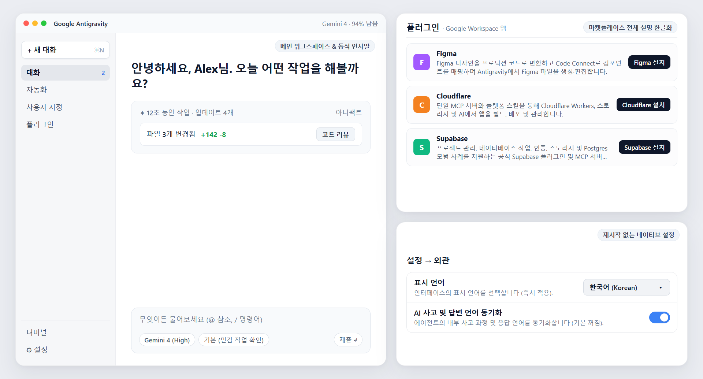

<div align="center">

# antigravity-langpack

**Google Antigravity(Stable & Insiders)** 및 **Antigravity IDE** 순수 텍스트 네이티브 한글화·다국어 언어팩.  
단일 경량 데몬으로 IDE 호스트 언어팩 자동 동기화와 기본 언어팩이 지원하지 않는 **우측 Agent 패널 · Antigravity Settings · Swarm 보드 · 인라인 버튼** 실시간 번역을 동시에 처리합니다 (app.asar 무개조 · macOS 공식 서명 유지 · 15개 오프라인 사전 각 2,865개 항목).

<p>
  <a href="../README.md">English</a> ·
  <a href="./README.zh-CN.md">简体中文</a> ·
  <a href="./README.zh-TW.md">繁體中文</a> ·
  <a href="./README.ja.md">日本語</a> ·
  <b>한국어</b> ·
  <a href="./README.ru.md">Русский</a>
</p>

<p>
  
  <a href="../LICENSE"></a>
</p>


</div>

## 화면 미리보기 (워크스페이스 · 마켓플레이스 전체 한글화 · 15개 언어)

<p align="center">
  
</p>

<p align="center">
  
</p>

## 설치

관리자 권한(`sudo`)이 필요하지 않습니다. 시스템에 `Node.js >= 22.13`이 없는 경우 공식 `SHASUMS256.txt` 검증을 거친 포터블 런타임을 `.runtime/` 폴더에 자동 구성합니다.

```bash
# macOS / Linux
curl -fsSL https://raw.githubusercontent.com/CHANPAJN/antigravity-langpack/main/install.sh | sh -s -- --lang ko
```

```powershell
# Windows (PowerShell)
$env:AGY_LANG='ko'; irm https://raw.githubusercontent.com/CHANPAJN/antigravity-langpack/main/install.ps1 | iex
```

**AI 프롬프트 한 줄 설치** ([AI_INSTALL.md](../AI_INSTALL.md))

```text
https://github.com/CHANPAJN/antigravity-langpack/blob/main/AI_INSTALL.md 문서를 읽고 Antigravity 한국어 패치(ko)를 설치해 줘.
```

**소스 코드 클론 설치**

```bash
git clone https://github.com/CHANPAJN/antigravity-langpack.git
cd antigravity-langpack
node cli.mjs install --lang ko
```

## 사용법 및 CLI

**`설정 (Settings) → 모양 (Appearance)`** 에서 재시작 없이 **「표시 언어」** 를 즉시 전환할 수 있으며, 아래의 **「AI 사고 및 답변 언어 동기화」** 스위치(기본 꺼짐)로 에이전트 응답 언어를 함께 맞출 수 있습니다.

```bash
node cli.mjs status          # 데몬 상태 및 포트 확인
node cli.mjs lang ko         # 언어 즉시 전환 (en 입력 시 원본 영어 복원)
node cli.mjs ai-lang on      # AI 사고·응답 언어 동기화 켜기 (off 로 끄기)
node cli.mjs sync-ai         # 읽기 전용 샌드박스 기반 신규 문구 증분 번역
node cli.mjs uninstall       # 제거 및 원본 영어 UI 즉시 복원
```

## 아키텍처 및 프라이버시

- **무침투 이벤트 구동**: `127.0.0.1` 단일 영구 CDP WebSocket 이벤트 스트림(유휴 CPU 약 `0.0%`)으로 동작하며 설치 파일이나 `app.asar`를 수정하지 않습니다.
- **DOM 격리 및 `WeakMap` 복원**: 코드 에디터, 터미널, 채팅 본문을 건드리지 않으며 `WeakMap` 매핑으로 창 재시작 없이 즉시 언어를 전환합니다.
- **기본 비활성화 원칙**: 백그라운드 수집, 자동 AI 번역, AI 언어 규칙 동기화는 모두 기본값 `false`이며 강제 종료(`SIGKILL` / `-Force`)를 절대 사용하지 않습니다.

## 라이선스

[GNU General Public License v3.0 (GPL-3.0)](../LICENSE) 라이선스를 따릅니다.
