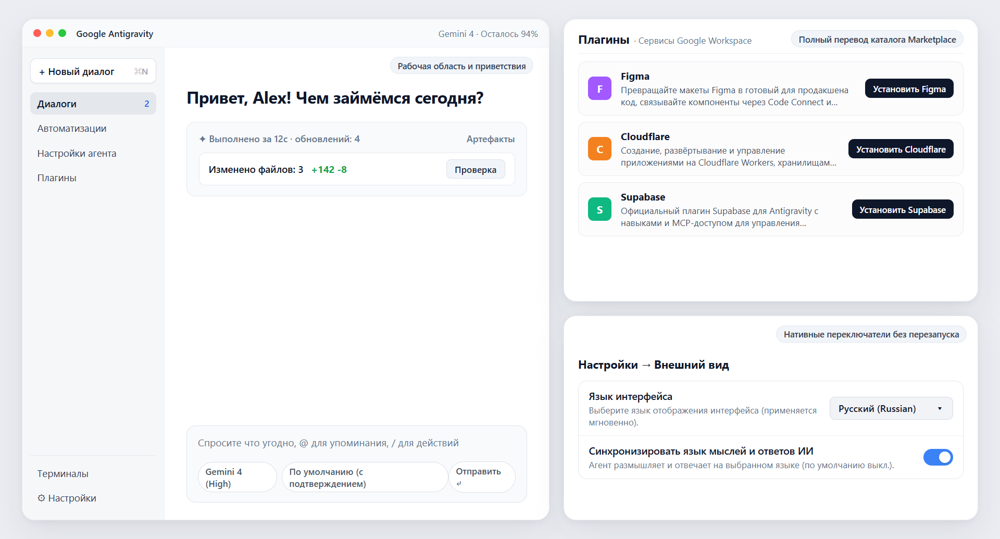
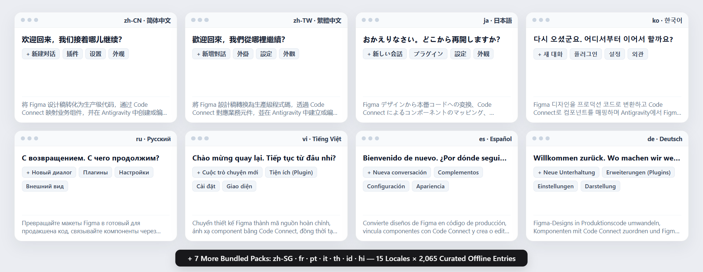

<div align="center">

# antigravity-langpack

Нативный текстовый языковой пакет и русификатор для **Google Antigravity (Stable и Insiders)** и **Antigravity IDE**.  
Один лёгкий фоновый демон синхронизирует официальный языковой пакет оболочки IDE и переводит встроенную **боковую панель Agent, настройки Antigravity Settings, панель Swarm и инлайн-кнопки** — без модификации app.asar, с сохранением подписи macOS · 15 офлайн-локалей по 2 865 строк.

<p>
  <a href="../README.md">English</a> ·
  <a href="./README.zh-CN.md">简体中文</a> ·
  <a href="./README.zh-TW.md">繁體中文</a> ·
  <a href="./README.ja.md">日本語</a> ·
  <a href="./README.ko.md">한국어</a> ·
  <b>Русский</b>
</p>

<p>
  
  <a href="../LICENSE"></a>
</p>


</div>

## Обзор интерфейса (Рабочая область · Полный перевод Marketplace · 15 языков)

<p align="center">
  
</p>

<p align="center">
  
</p>

## Установка

Права администратора / `sudo` не требуются. Если в системе отсутствует `Node.js >= 22.13`, скрипт автоматически загрузит официальный портативный рантайм с проверкой `SHASUMS256.txt` в каталог `.runtime/`.

```bash
# macOS / Linux
curl -fsSL https://raw.githubusercontent.com/CHANPAJN/antigravity-langpack/main/install.sh | sh -s -- --lang ru
```

```powershell
# Windows (PowerShell)
$env:AGY_LANG='ru'; irm https://raw.githubusercontent.com/CHANPAJN/antigravity-langpack/main/install.ps1 | iex
```

**Установка через ИИ-агента одной строкой** ([AI_INSTALL.md](../AI_INSTALL.md))

```text
Прочитай https://github.com/CHANPAJN/antigravity-langpack/blob/main/AI_INSTALL.md и установи русификатор Antigravity (ru).
```

**Ручная установка из исходников**

```bash
git clone https://github.com/CHANPAJN/antigravity-langpack.git
cd antigravity-langpack
node cli.mjs install --lang ru
```

## Использование и CLI

Откройте **`Настройки (Settings) → Внешний вид (Appearance)`** для мгновенной смены языка без перезапуска окна и опционального включения переключателя **«Синхронизировать язык мыслей и ответов ИИ»** (по умолчанию выключен).

```bash
node cli.mjs status          # Статус фонового демона и активных портов
node cli.mjs lang ru         # Мгновенное переключение языка (en — оригинал)
node cli.mjs ai-lang on      # Включить синхронизацию языка мыслей и ответов ИИ (off — выкл.)
node cli.mjs sync-ai         # Доперевод новых строк в изолированной песочнице
node cli.mjs uninstall       # Удаление и мгновенный возврат к английскому UI
```

## Архитектура и приватность

- **Событийное подключение CDP**: одно постоянное локальное соединение `127.0.0.1` (`~0.0%` CPU в простое), нулевое вмешательство в `app.asar` и системные каталоги.
- **Изоляция DOM и `WeakMap`**: редактор кода Monaco, терминал и сообщения чата не затрагиваются; переключение языка выполняется в памяти без перезапуска IDE.
- **Строгий Opt-In**: сбор непереведённых фраз, фоновый ИИ-перевод и синхронизация правил ИИ по умолчанию отключены (`false`).

## Лицензия

Распространяется на условиях [GNU General Public License v3.0 (GPL-3.0)](../LICENSE).
