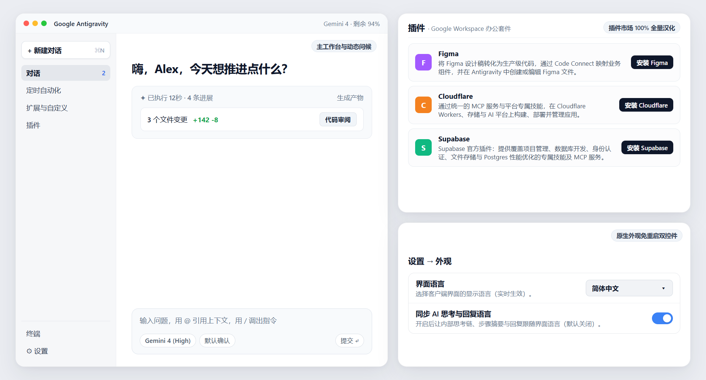

<div align="center">

# antigravity-langpack

**Google Antigravity（正式版 Stable & 预览版 Insiders）**、**Antigravity IDE** 与 **VS Code 官方插件版（`Google.google-antigravity`）** 纯文本原生多语言界面包。  
同一个轻量守护进程按所选语种自动同步对应的 IDE 外壳语言包，并将官方语言包覆盖不到的**右侧 Agent 面板、Antigravity Settings 专属设置页、斜杠命令与内置技能说明、Swarm 协作看板、系统通知卡片、按需上下文菜单与行内 Diff/补全按钮**实时本地化——不改 app.asar、保留 macOS 官方公证签名，内置 15 套离线词库（每套 2,893 条）。

<p>
  <a href="../README.md">English</a> ·
  <b>简体中文</b> ·
  <a href="./README.zh-TW.md">繁體中文</a> ·
  <a href="./README.ja.md">日本語</a> ·
  <a href="./README.ko.md">한국어</a> ·
  <a href="./README.ru.md">Русский</a>
</p>

<p>
  
  
  <a href="../LICENSE"></a>
  <a href="https://linux.do"></a>
</p>


</div>

## 界面实景（主工作台 · 插件市场全量汉化 · 15 国词库）

<p align="center">
  
</p>

<p align="center">
  
</p>

## 安装

无需管理员或 `sudo` 权限。若本机未安装 `Node.js >= 22.13`，安装脚本会自动拉取经官方 `SHASUMS256.txt` 校验的独立便携运行时至私有 `.runtime/` 目录。

**macOS / Linux**

```bash
curl -fsSL https://raw.githubusercontent.com/CHANPAJN/antigravity-langpack/main/install.sh | sh
```

**Windows (PowerShell)**

```powershell
irm https://raw.githubusercontent.com/CHANPAJN/antigravity-langpack/main/install.ps1 | iex
```

**AI 对话一键配置**（粘贴至 Antigravity / Claude Code / Cursor，详见 [AI_INSTALL.md](../AI_INSTALL.md)）

```text
请阅读 https://github.com/CHANPAJN/antigravity-langpack/blob/main/AI_INSTALL.md 并帮我安装激活 Antigravity 简体中文语言包（zh-CN）。
```

**源码克隆安装**

```bash
git clone https://github.com/CHANPAJN/antigravity-langpack.git
cd antigravity-langpack
node cli.mjs install                # 默认 zh-CN，可传 --lang zh-SG / zh-TW / ja / ko / ru
node cli.mjs install --mac-launcher # 可选：macOS 生成纯脚本 Dock 启动器
```

## 使用与命令

安装后打开 **`设置 → 外观`** 即可使用两项原生控件：

- **界面语言**：免重启即时切换 15 套本地词库与原版 `English (Default)`。
- **同步 AI 思考与回复语言**：默认关闭（`false`）；按需开启后自动让智能体的内部思考链、步骤摘要与回复跟随当前界面语言。

```bash
node cli.mjs status          # 查看守护进程、当前语种与连接端口
node cli.mjs lang            # 列出全部 15 套词库及词条数
node cli.mjs lang zh-SG      # 命令行即时切换语种（如保留英文技术词版 zh-SG 或 en）
node cli.mjs ai-lang on      # 开启 AI 思考与回复语言同步（传 off 关闭）
node cli.mjs sync-ai         # 按需在只读沙箱内扫描并增量翻译新版新增按钮
node cli.mjs check           # 校验仓库零二进制文件与全部脚本/JSON 语法
node cli.mjs uninstall       # 卸载服务并立即无损恢复原版英文界面
```

## 架构与透明边界

- **四端按需同频接管（Stable + Insiders + IDE + VS Code 插件版）**：零额外后台进程，装一次同时覆盖桌面端、`Antigravity IDE` 以及安装了 `Google.google-antigravity` 扩展的原版 VS Code（未安装该扩展的普通 VS Code 保持零触碰），在任一端 `设置 → 外观` 切换语言即可同步生效。
- **无侵入事件流挂载**：守护进程仅通过 `127.0.0.1` 建立单条持久化 CDP WebSocket（监听 `Page.frameNavigated`、`Target.targetCreated` 与 `Runtime.bindingCalled`，空闲 CPU 约 `0.0%`），不触碰客户端安装目录与 `app.asar`。
- **DOM 隔离、按需上下文菜单与 `WeakMap` 还原**：严格跳过 Monaco 代码编辑器、左侧文件树、顶部代码标签页、用户自定义目录/分组/分支名、集成终端、代码块与插件原生文档，同时精准覆盖系统通知气泡与瞬时触发的上下文菜单（待机与流式输出零额外开销）；通过 `WeakMap` 保存原始文本节点，切换语言或切回英文时内存级直接还原。
- **冷启动端口补参（`autoRelaunchCdp: true`）**：Windows 自动为桌面与任务栏快捷方式补齐调试端口参数；若从 `antigravity-ide://` 协议链接或自定义代理脚本裸启动未带调试口，仅在进程刚启动 `<15s` 且无近期对话写入时自动继承原代理变量与启动参数、发送温和关闭请求（`CloseMainWindow` / `SIGTERM`，绝不使用 `-Force` 或 `SIGKILL` 强杀）并带参重开一次，可在 `dict/config.json` 中设为 `false` 关闭。
- **默认零采集与零越界配置**：`collectUntranslated`、`autoSyncAi`、`syncAiOutputLang` 默认全部为 `false`，默认安装不修改 `~/.gemini/config/` 下的任何规则或技能文件。

## 预置词库（15 套 × 2,893 条，覆盖设置全子项、斜杠命令与内置技能说明、插件市场与 Swarm 看板）

`zh-CN` 简体中文 · `zh-SG` 简体中文（英文术语） · `zh-TW` 繁體中文 · `ja` 日本語 · `ko` 한국어 · `ru` Русский · `vi` Tiếng Việt · `hi` हिन्दी · `id` Bahasa Indonesia · `th` ภาษาไทย · `es` Español · `fr` Français · `de` Deutsch · `pt` Português · `it` Italiano

## 许可协议

基于 [GNU General Public License v3.0 (GPL-3.0)](../LICENSE) 开源发布。感谢 [LINUX DO](https://linux.do) 社区的交流与反馈支持。
