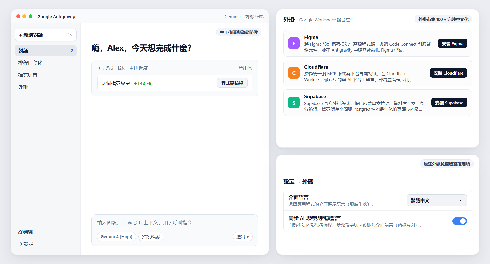

<div align="center">

# antigravity-langpack

**Google Antigravity（Stable & Insiders）**、**Antigravity IDE** 與 **VS Code 官方擴充套件版（`Google.google-antigravity`）** 純文字原生多語系介面包。  
同一個輕量背景服務按所選語系自動同步對應之 IDE 外殼語言包，並將官方語言包未涵蓋的**右側 Agent 面板、Antigravity Settings 專屬設定頁、Swarm 協作看板與行內 Diff/補全按鈕**即時在地化——免改 app.asar、保留 macOS 官方公證簽章，內建 15 套離線詞庫（每套 2,865 條）。

<p>
  <a href="../README.md">English</a> ·
  <a href="./README.zh-CN.md">简体中文</a> ·
  <b>繁體中文</b> ·
  <a href="./README.ja.md">日本語</a> ·
  <a href="./README.ko.md">한국어</a> ·
  <a href="./README.ru.md">Русский</a>
</p>

<p>
  
  
  <a href="../LICENSE"></a>
</p>


</div>

## 介面預覽（工作區 · 外掛市集完整中文化 · 15 國詞庫）

<p align="center">
  
</p>

<p align="center">
  
</p>

## 安裝

無須管理員或 `sudo` 權限。若本機未安裝 `Node.js >= 22.13`，安裝腳本會自動下載經官方 `SHASUMS256.txt` 驗證之獨立執行環境至私有 `.runtime/` 目錄。

```bash
# macOS / Linux
curl -fsSL https://raw.githubusercontent.com/CHANPAJN/antigravity-langpack/main/install.sh | sh -s -- --lang zh-TW
```

```powershell
# Windows (PowerShell)
$env:AGY_LANG='zh-TW'; irm https://raw.githubusercontent.com/CHANPAJN/antigravity-langpack/main/install.ps1 | iex
```

**AI 對話一鍵安裝**（貼入 Antigravity / Claude Code / Cursor，詳見 [AI_INSTALL.md](../AI_INSTALL.md)）

```text
請閱讀 https://github.com/CHANPAJN/antigravity-langpack/blob/main/AI_INSTALL.md 並幫我安裝啟用 Antigravity 繁體中文語言包（zh-TW）。
```

**原始碼安裝**

```bash
git clone https://github.com/CHANPAJN/antigravity-langpack.git
cd antigravity-langpack
node cli.mjs install --lang zh-TW
```

## 使用與指令

開啟 **`設定 (Settings) → 外觀 (Appearance)`** 即可免重啟即時切換 **「介面語言」**，並可按需開啟 **「同步 AI 思考與回覆語言」**（預設關閉）。

```bash
node cli.mjs status          # 檢視背景服務與連線埠狀態
node cli.mjs lang zh-TW      # 即時切換語言（傳入 en 還原英文）
node cli.mjs ai-lang on      # 選用：同步 AI 思考與回覆語言（off 關閉）
node cli.mjs sync-ai         # 按需於唯讀沙箱掃描並補齊新版未翻譯字串
node cli.mjs uninstall       # 解除安裝並還原原版英文介面
```

## 架構與隱私邊界

- **零修改掛載**：透過 `127.0.0.1` 單一持久化 CDP WebSocket 事件驅動（閒置 CPU 約 `0.0%`），不修改 `app.asar` 與安裝目錄，常規更新免重打修補程式。
- **DOM 隔離與無損還原**：嚴格略過程式碼編輯器、終端機與對話內容，以 `WeakMap` 實現免重啟即時切換與還原。
- **預設全關**：`collectUntranslated`、`autoSyncAi`、`syncAiOutputLang` 預設皆為 `false`，不擅自改動 `~/.gemini/config/`；冷啟動除錯埠補參（`autoRelaunchCdp`）僅對剛啟動 `<15s` 且無近期寫入之新處理程序發送溫和關閉請求（絕不使用強制終止）。

## 授權條款

採用 [GNU General Public License v3.0 (GPL-3.0)](../LICENSE) 開源授權條款。
